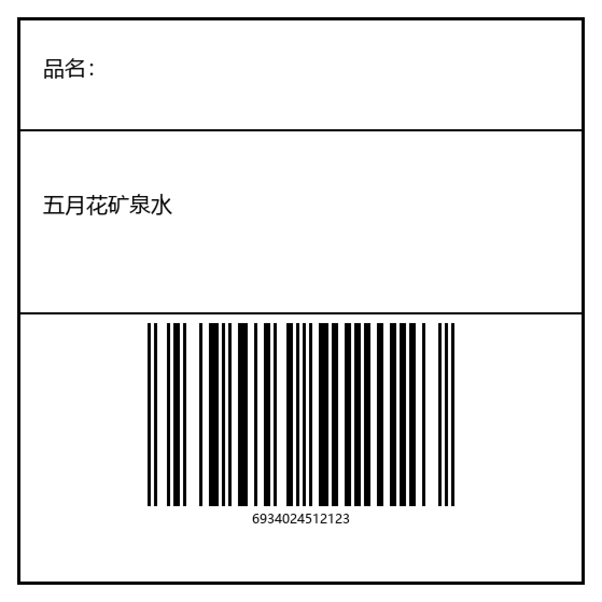

# zebra-printer-skill

一个**自带引擎**的 Hermes skill：给一张标签照片就能反推成 ZPL，或者直接用自然语言描述要打什么，就能打到 Zebra 打印机上。

不需要克隆 `zebra-printer-mcp`，不需要注册 MCP 服务器，不需要 MCP SDK。装好这个目录、跑一次 setup 即可。

## 文档

| 文档 | 内容 |
|---|---|
| [`docs/install.md`](docs/install.md) | **完整安装与配置**：三种安装位置、依赖清单与离线安装、打印机三种接法、验证、升级、卸载、故障排查表 |
| [`SKILL.md`](SKILL.md) | agent 用的操作手册：触发条件、两条主任务、停止判据、硬性纪律 |
| [`references/spec-schema.md`](references/spec-schema.md) | label spec 全键表、28 种条码的参数位序与默认值 |
| [`references/calibration.md`](references/calibration.md) | 照片复刻六条校准规则（实机 99%） |
| [`vendor/PROVENANCE.md`](vendor/PROVENANCE.md) | 内置引擎的来源与上游同步方法 |

## 安装（干净机器，一次性）

```bash
python scripts/setup.py          # 建 .venv，装 7 个包（首次约 80 MB）
python scripts/setup.py --check  # 只检查
```

之后所有命令用 skill 自己的解释器：

```bash
PY="<skill>/.venv/Scripts/python.exe"    # Windows
PY="<skill>/.venv/bin/python"            # macOS / Linux
```

```bash
export ZEBRA_HOST=<打印机IP>              # 打印机地址，设一次
$PY scripts/label.py status              # 0000 = PRINTER READY
```

## 三种主用法

**照片 -> ZPL -> 打印**

```bash
$PY scripts/label.py photo 标签.jpg --width 70 --height 70 --paper 76 --paper-height 70 \
    --dry-run --out scratch/a.zpl --preview scratch/a.png

# 看过 elements / warnings 后去掉 --dry-run 就出纸
$PY scripts/label.py photo 标签.jpg --width 70 --height 70 --paper 76 --paper-height 70
```

`--width/--height` 是**图案**尺寸，`--paper/--paper-height` 是**纸**尺寸（模切料常是 76 mm 纸载 70 mm 图案，只给前者会整体缩 8%）。

**自然语言 -> 标签**

写一份 spec JSON，然后一条命令走完 build -> validate -> 渲染 -> 发送：

```bash
$PY scripts/label.py print spec.json --dry-run --preview scratch/b.png
$PY scripts/label.py print spec.json
```

spec 的字段全表见 `references/spec-schema.md`（20 个顶层键、7 种 field type、28 种条码的位序与默认值）。

### 表格框商品标签

`examples/product-70x70.spec.json` —— 70×70 mm 模切料，三行：品名 / 五月花矿泉水 / EAN-13。改 `data` 就换品名和条码。



**批量 Excel -> 一批标签**

```bash
$PY scripts/label.py xlsx examples/employees.xlsx --width 50 --height 30 \
    --dry-run --preview scratch/first.png
$PY scripts/label.py xlsx examples/employees.xlsx --width 50 --height 30
```

A 列文字、B 列条码，一行一条标签。整批拼成**一条 ZPL 流、一次 TCP 连接**发出去，回显只读一次。列可以给 Excel 字母（`A`）、序号（`2`）或表头名（`--name-column 姓名`）。**条码列必须是 ASCII**，中文放文字列。

## 子命令

| 命令 | 作用 |
|---|---|
| `photo <image>` | 照片 -> ZPL（可同时打印） |
| `build <spec.json>` | spec -> ZPL |
| `validate <file>` | 按手册命令目录校验 |
| `render <file.zpl>` | 离线渲染 PNG，先看版式 |
| `status` | `~HI`/`~HS` 查型号与状态字 |
| `send <file.zpl>` | 发送（tcp / windows 队列 / usb） |
| `print <spec.json>` | build+validate+render+send |
| `printers` | 列 Windows 打印队列 |
| `xlsx <file.xlsx>` | 一行一条标签（姓名 + Code128），整批拼一条 ZPL 流 |
| `knowledge [query]` | 查 ZPL 手册：`--mode command/search/barcodes/sgd/status/list` |

全部输出 JSON，出错退出码 1。

## 目录

| 路径 | 内容 |
|---|---|
| `SKILL.md` | 触发条件、安装、三条主任务、停止判据、七条纪律 |
| `references/spec-schema.md` | label spec 全键表 + 28 制式位序 |
| `references/calibration.md` | 照片复刻六条校准规则（实机 99%） |
| `vendor/wheels/zpl_core-0.1.0-py3-none-any.whl` | 引擎本体（wheel，14.1 MB，含命令目录与 OCR 模型） |

| `templates/` | 两张实机验证过的 70×70 标签 |
| `examples/` | 商品标签 spec + 渲染图 + 员工表样例（`xlsx` 用） |
| `scripts/` | `setup.py`（建 venv + 校验 wheel 哈希）/ `label.py`（10 个子命令） |
| `tests/test_skill.py` | 自检 |

## 自检

```bash
$PY tests/test_skill.py     # -> ALL CHECKS PASSED
```

## 边界

不做 RFID、`^GF` 位图流、`~DG` 字体下载、SNMP 监控、并发调度。校验通过不代表码能扫——静区、模块宽、纠错级只有纸和扫码枪能确认。表格线不会从照片自动重建，需要时补 `^GB`。

## License

MIT（`vendor/` 内含的 PaddleOCR 模型为 Apache-2.0）
